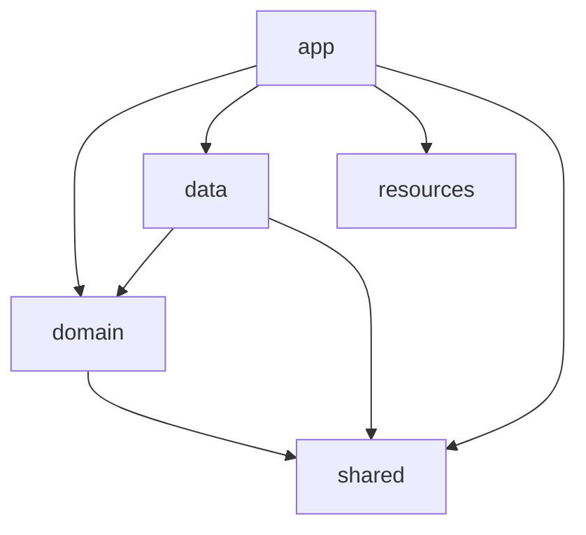

# Kotlin MVVM Base — Multi-module theo layer

Ứng dụng Android mẫu dùng Clean Architecture, MVVM, Jetpack Compose và Hilt.
Project gồm **5 Gradle module chia theo trách nhiệm/layer**. Các màn hình Todo và Users
là package bên trong `app`; chúng không phải Gradle module riêng.

## Trách nhiệm và chiều phụ thuộc

| Module | Loại | Trách nhiệm | Phụ thuộc module |
| --- | --- | --- | --- |
| `app` | Android application | Compose, ViewModel, navigation, Android session adapter, Hilt composition root | `domain`, `data`, `shared`, `resources` |
| `domain` | Kotlin/JVM | Entity, repository/session contract, use case | `shared` |
| `data` | Kotlin/JVM | Repository implementation, Retrofit, DTO, mapping, data source | `domain`, `shared` |
| `shared` | Kotlin/JVM | Result, lỗi, logging, dispatchers, retry | Không có |
| `resources` | Android library | Theme, màu sắc, chuỗi và tài nguyên giao diện | Không có |



`app` được phép tham chiếu implementation trong `data` để lắp ghép dependency bằng Hilt.
Screen và ViewModel chỉ sử dụng domain contract/use case. `domain` không chứa navigation,
Compose, Android SDK, Retrofit hoặc annotation của DI framework.

`DataStoreSessionManager` ở `app/session` vì đây là adapter phụ thuộc Android.
Contract `SessionManager` ở `domain/session`; phần Kotlin/JVM không phụ thuộc DataStore.
`AppRoute`, `AppNavigator` và adapter `NavController` ở `app/navigation`.

Task `verifyModuleBoundaries` kiểm tra các project dependency theo bảng trên, kể cả
dependency mới được thêm vào cấu hình test. Dependency từ test tới chính module của nó được phép.
Task này cũng được chạy tự động cùng `check` của từng module.

## Hilt và khởi động

Hilt được cấu hình ở `app`: `MainApplication` dùng `@HiltAndroidApp`, Activity dùng
`@AndroidEntryPoint`, mỗi ViewModel dùng `@HiltViewModel` và constructor injection.

Các Hilt module trong `app/di`:

- `AppModule`: logger, dispatcher provider, application coroutine scope và DataStore session.
- `DataModule`: Gson, Retrofit, service, data source và repository implementation.
- `DomainModule`: cung cấp use case với dispatcher được inject.

Khởi động chỉ chờ session qua `SessionManager.state`: `Loading` hiển thị tiến trình,
`Ready` mở ứng dụng, `Error` hiển thị nút Retry gọi `retryRestore()`.
Không cần module điều phối khởi động tổng quát cho một tác vụ đọc session.
ViewModel được lấy bằng `hiltViewModel()` trong từng destination, nên sống theo back stack entry.

## Use case và xử lý dữ liệu

Các base class có định nghĩa duy nhất ở `domain/usecase/base`:

- `BaseSuspendUseCase<P, R>`: `execute` trả về giá trị; `invoke` trả về `Result<R>`.
- `BaseUseCase<P, R>`: tên ngắn cho cùng cơ chế suspend ở trên.
- `BaseNoParamsUseCase<R>`: hỗ trợ gọi `useCase()` với `NoParams`.
- `BaseSyncUseCase<P, R>`: xử lý đồng bộ.
- `BaseFlowUseCase<P, R>`: trả về `Flow<Result<R>>`, kể cả lỗi khi tạo Flow.
- `BasePagingUseCase<P, R>`: sử dụng `PagingInput` và `PageResult<R>`.

Không bắt buộc Input/Output phải kế thừa marker interface. Import trực tiếp từ package
`usecase.base`; không có facade mô phỏng Dart barrel export.

Repository chuẩn hóa lỗi kỹ thuật thành `Result.Failure`. Use case có thể dùng
`getOrThrow()` để kết hợp kết quả; base giữ nguyên `AppException` và luôn ném lại
`CancellationException`. Inject test dispatcher khi kiểm tra coroutine.

Todo sử dụng data source trong bộ nhớ và đồng bộ các thao tác ghi bằng Mutex.
`ObserveTodosUseCase` theo dõi source of truth `TodoRepository.getTodosFlow()`.
Repository phải phát danh sách mới qua Flow khi ghi thành công; ViewModel không gọi
đọc lại sau mỗi lần thêm/toggle. Lỗi observation có nút thử tải danh sách riêng,
không biến một lần ghi đã thành công thành lỗi mutation hoặc thực hiện lại lần ghi đó.

Bản nháp Todo nằm trong `SavedStateHandle`, được giữ khi xoay màn hình và có thể được
khôi phục qua cơ chế saved state sau process recreation. Chỉ xóa bản nháp khi thêm
thành công và nội dung hiện tại vẫn là bản đã gửi; lỗi ghi hoặc bản nháp mới vẫn được giữ.
Validation tiêu đề thuộc `AddTodoUseCase`; UI chỉ kiểm tra để bật/tắt nút.

Sử dụng trực tiếp các operator Kotlin Flow như `distinctUntilChanged`, `debounce` và
`flatMapLatest`, thay vì tạo alias không bổ sung hành vi.

Users sử dụng Retrofit với endpoint công khai `https://jsonplaceholder.typicode.com/users`,
có `_page`/`_limit`. Client công khai không gắn access/refresh token.

## State, thông báo và retry

UI collect state bằng `collectAsStateWithLifecycle()`. `BaseViewModel` cung cấp:

- `loadingKeys`: bộ đếm từng tác vụ; initial/submit hiển thị overlay, pagination có indicator riêng.
- `effects`: danh sách thông báo/navigation chờ xử lý, có ID và giữ trong ViewModel tới khi UI xác nhận.
- `onEffectHandled(id)`: xóa effect sau khi xử lý xong hoặc đóng dialog.
- `launchOperation`: cập nhật kết quả và chọn hiển thị lỗi đúng một lần.

`BaseScreen` chỉ xử lý effect khi lifecycle ở trạng thái STARTED. Thông báo đang chờ
còn trong ViewModel qua thay đổi cấu hình; chúng không được persist qua process death.
Không phát snackbar thủ công trong `onFailure` nếu vẫn bật `showError`.
Màn hình có error state và nút Retry riêng nên dùng `showError = false`.

Retry mặc định bị tắt. Chỉ đặt `allowRetry = true` cho thao tác cho phép thực thi lại.
`RetryConfig` chỉ có hiệu lực khi đã cho phép replay; lỗi cũng phải có `retryable = true`.
Các thao tác ghi Todo không tự động replay, tránh thực hiện lại mutation sau lỗi.
Nút Load more thực hiện yêu cầu mới theo state hiện tại khi tải trang thất bại.

```kotlin
launchOperation(
    key = LoadingKey.Initial,
    allowRetry = true,
    showError = false,
    action = { getUsersUseCase(GetUsersInput()) },
    onSuccess = { page -> /* cập nhật state */ },
    onFailure = { error -> /* cập nhật error state có nút Retry */ }
)
```

## Session

Session có một state duy nhất được cập nhật nguyên tử:

- `SessionState.Loading`: đang đọc/khôi phục.
- `SessionState.Ready(session, isExpired)`: snapshot nhất quán; có thể chưa đăng nhập.
- `SessionState.Error(cause)`: lỗi đọc hoặc collector đã kết thúc, có thể gọi `retryRestore()`.

Session được khôi phục trước khi mở màn hình. `save` thay thế cả các trường tùy chọn,
nên refresh token/user ID cũ bị xóa nếu session mới không có chúng.

Lỗi collector sau khi đã Ready cũng được đưa vào state; các lệnh ghi đang chờ state
nhận lỗi đó và kết thúc, thay vì chờ vô hạn. Retry tạo collection mới, không cache
report lỗi suốt vòng đời application. Các thao tác ghi được tuần tự hóa bằng Mutex.

`expire()` xóa thông tin đăng nhập và lưu trạng thái hết phiên. App quan sát `Ready.isExpired`
để chuyển tới Login và xóa back stack. Việc vô hiệu hóa session không phụ thuộc vào
snackbar hay sự tồn tại của screen collector. Đăng nhập thành công qua `save()` sẽ xóa
trạng thái hết phiên; `clear()` xóa toàn bộ session.

Login hiện chỉ là destination mẫu, chưa có backend đăng nhập/refresh token.
Preferences DataStore không mã hóa token; ứng dụng thật cần bổ sung cơ chế lưu trữ an toàn
và client xác thực riêng theo hợp đồng backend. Test token refresh của client cũ đã được
thay bằng test Retrofit thực tế; base không tuyên bố đã có refresh-token implementation.

## Build và kiểm tra

Toolchain đang dùng Kotlin 1.9.23, AGP 8.3.1, Gradle wrapper 8.11.1 và JVM target 17.
Cần Android SDK 34. JDK 21 đã được dùng để kiểm tra project này; cấu hình Gradle JDK
trong Android Studio hoặc `JAVA_HOME` của terminal tương ứng.
Project local đã cấu hình `#GRADLE_LOCAL_JAVA_HOME` trỏ tới JDK 21 trong
`.gradle/config.properties`; đây là file cấu hình theo máy, không đưa vào Git.
Robolectric dùng để kiểm tra saved state và round-trip navigation trên JVM;
test Android mô phỏng chạy API 36 với JDK 21.

```powershell
.\gradlew.bat verifyModuleBoundaries
.\gradlew.bat :app:assembleDebug
.\gradlew.bat :domain:test :data:test :shared:test :app:testDebugUnitTest
.\gradlew.bat :app:lintDebug
```

Test bao gồm Retrofit/MockWebServer, HTTP/JSON error mapping, use case cancellation,
Flow construction failure, retry backoff, concurrent Todo writes, DataStore session
replacement/expiration, lỗi đọc sau Ready và retry khôi phục, effect/loading của ViewModel,
khôi phục bản nháp, ghi thành công nhưng đọc Flow thất bại, và ID navigation có khoảng trắng,
dấu cộng, dấu gạch chéo hoặc Unicode. Các test này không yêu cầu backend thật.

Build/test/lint thành công chưa chứng minh hiệu năng runtime đã tối ưu. Cần kiểm thử
trên thiết bị và profiling riêng trước khi kết luận về hiệu năng.

## Thêm màn hình

1. Thêm entity, repository contract và use case vào `domain` khi cần.
2. Thêm DTO, service/data source và repository implementation vào `data`.
3. Khai báo các provider tương ứng trong Hilt composition root `app/di`.
4. Thêm package `app/ui/<screen>` chứa Screen, ViewModel và UiState.
5. Thêm route/destination trong `app/navigation`, lấy ViewModel ngay tại destination.

Giữ cấu trúc module theo layer này khi thêm màn hình; không cần tạo Gradle module cho mỗi feature.
# Kotlin-multi-module

